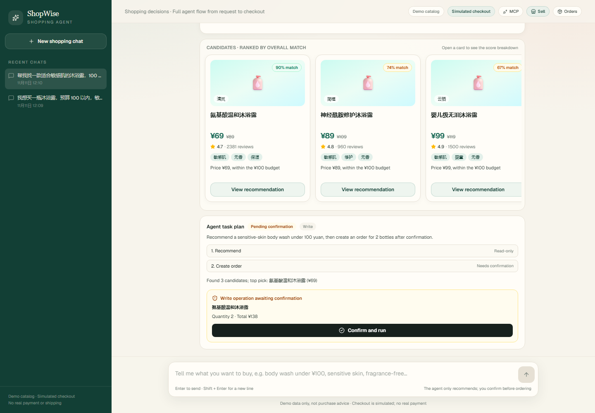
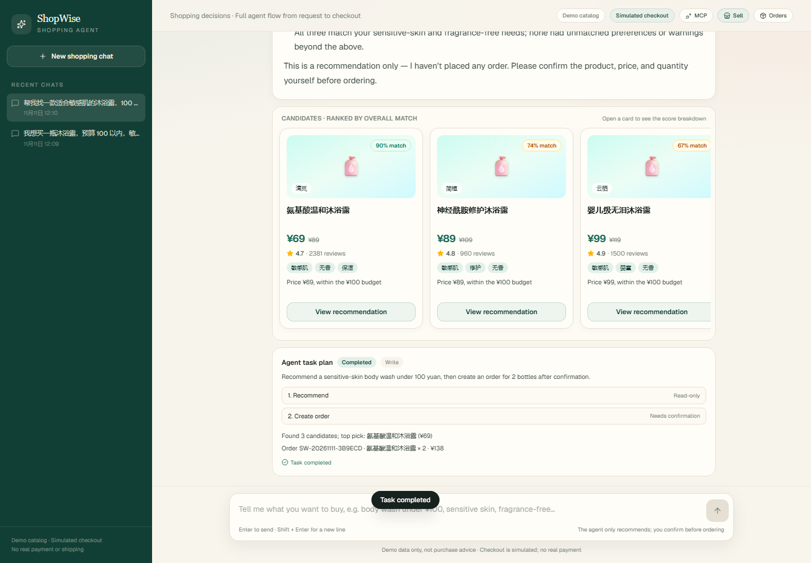
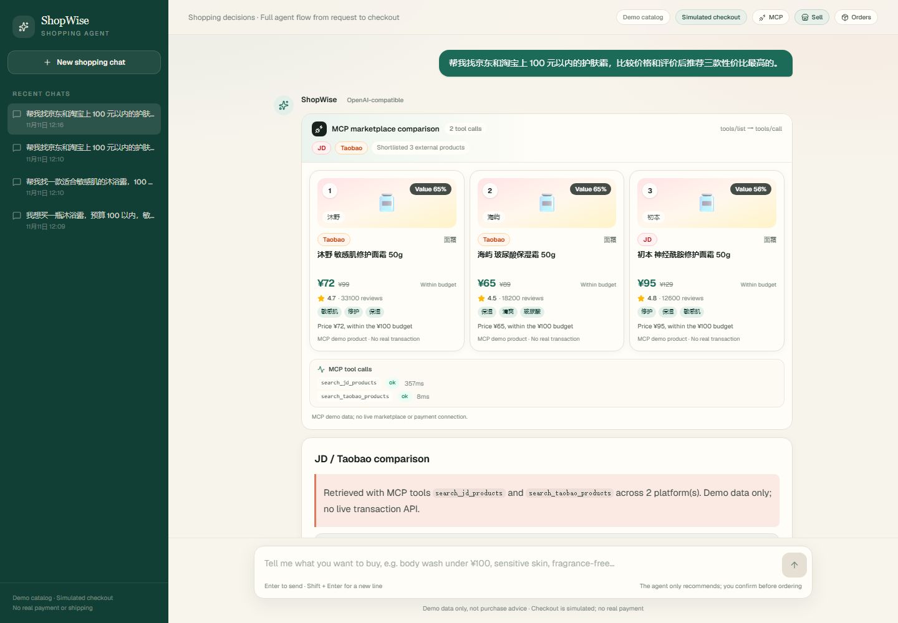
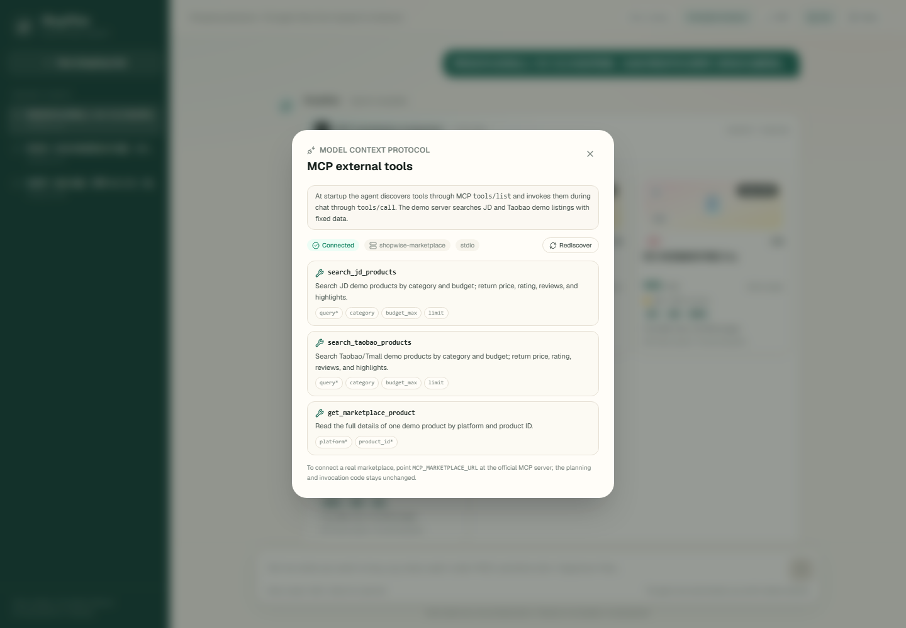
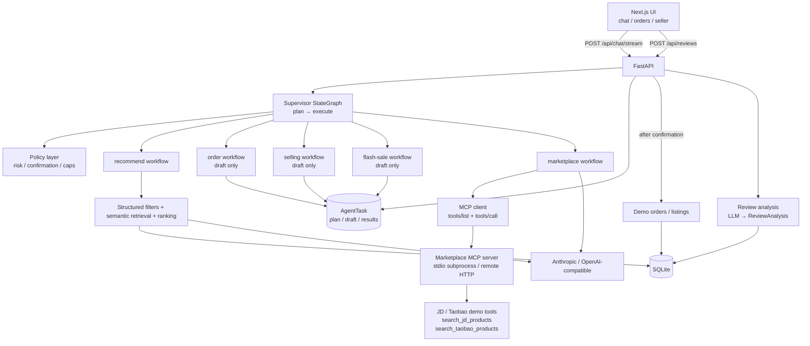
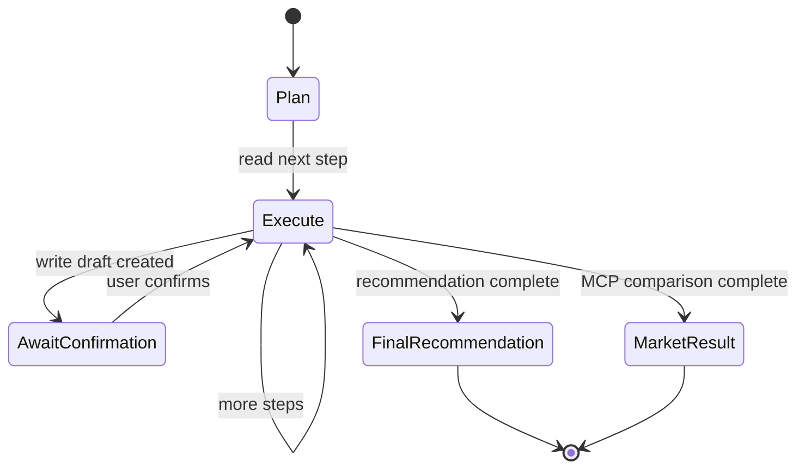

# ShopWise · Explainable Shopping Agent

> A full-stack agent that plans tasks, discovers external tools through MCP, compares products, explains its recommendation, and places a demo order only after the user confirms.


ShopWise is a portfolio project for learning and demonstrating agent application development. The demo catalog and example prompts are in Chinese; the code, UI, and documentation are in English.

---

## 1. What it does

A user can type in the bottom chat box:

> 我想买洗发水，预算 100 以内，可以去除头屑

or ask for an external marketplace comparison:

> 帮我找京东和淘宝上 100 元以内的护肤霜，比较价格和评价后推荐三款性价比最高的。

ShopWise will:

1. **Plan the task** — a supervisor agent chooses recommendation, ordering, selling, flash purchase, or marketplace comparison.
2. **Retrieve products** — structured filters plus optional embedding-based semantic retrieval; external products come through MCP tool calls.
3. **Analyze reviews** — ratings, review counts, pros and cons.
4. **Rank products** — price, rating, reviews, preference match, and semantic relevance, with an explainable score breakdown.
5. **Write a recommendation** — top-3 table, top pick, reasons, and caveats, streamed token by token.
6. **Confirm write operations** — order, listing, and flash-purchase drafts wait for explicit user confirmation.
7. **Review the purchase** — the buyer can write, view, and edit one review per order; an LLM structures it into sentiment, a summary, pros, cons, and tags for future shoppers.
8. **Sell a product** — a seller describes an item and sets the price/category; an LLM structures the listing into a product record that enters the buyer catalog immediately.
9. **Show the results** — the Orders and Sell panels reflect what the user bought and listed.
10. **Use external tools through MCP** — the agent discovers JD/Taobao search tools with `tools/list`, invokes them with `tools/call`, and compares price, rating, and review volume.

### Screenshots

| Home | Recommendation | Order details |
|---|---|---|
|  |  |  |

| Product details | Demo order created |
|---|---|
|  |  |

| View and edit a review | Structured review result | Seller listing created |
|---|---|---|
|  |  |  |

| Chat-agent task plan | Task completed after confirmation |
|---|---|
|  |  |

| MCP cross-marketplace comparison | MCP tool discovery |
|---|---|
|  |  |

---

## 2. Features

- [x] Product catalog with category, price, rating, and keyword filters
- [x] Optional semantic retrieval with embeddings and cosine similarity
- [x] Explainable multi-criteria ranking
- [x] Intent parsing with an LLM or a deterministic rule-based fallback
- [x] Mock mode that runs without API keys
- [x] SQLite persistence for sessions, messages, orders, and reviews
- [x] LangGraph `StateGraph` workflow with conditional branches
- [x] SSE streaming for stages, products, and recommendation tokens
- [x] Demo checkout with explicit user confirmation
- [x] Order history and order details
- [x] Post-purchase reviews with LLM structuring
- [x] Review viewing and editing; one review per order
- [x] Seller listings: free-text description → LLM-structured product → buyer catalog
- [x] Two-layer LangGraph agent: supervisor plans, workflow tools execute
- [x] Chat box as the agent entrypoint for recommend, buy, sell, flash purchase, and comparison
- [x] Recommendation, order, selling, and simulated flash-purchase skills
- [x] Policy gateway with risk levels, confirmation gates, quantity/price caps, and idempotent confirmation
- [x] Session replay with persisted product, task, and MCP result snapshots
- [x] MCP tool discovery with `tools/list` and invocation with `tools/call`
- [x] Bundled JD/Taobao marketplace MCP server and cross-platform value ranking
- [x] MCP tool-catalog panel and inline confirmation cards
- [x] Automated tests, Ruff, production build, and Playwright E2E
- [ ] Evaluation set, Docker, CI, and public deployment

---

## 3. Architecture



| Layer | Responsibility | Directory |
|---|---|---|
| UI | Chat agent, task cards, MCP comparison, product cards, checkout, reviews, seller center | `frontend/` |
| API | Routes, SSE, validation, errors | `backend/app/api/` |
| Agent | Supervisor planning, workflow tools, policy, prompts, provider abstractions | `backend/app/agent/` |
| MCP | Standard server, tool discovery, invocation, result normalization | `backend/app/mcp/` |
| Services | Catalog search, semantic scoring, ranking, reviews, sessions | `backend/app/services/` |
| Data | SQLModel tables, product embeddings, seed catalog | `backend/app/models.py`, `backend/app/data/` |

---

## 4. Tech stack

**Backend**

- Python 3.11+
- FastAPI + Uvicorn
- Pydantic v2 + SQLModel
- SQLite (development; PostgreSQL is a production option)
- LangGraph `StateGraph` (supervisor and recommendation subgraph)
- LangChain tools for recommendation, order, selling, flash sale, and comparison
- MCP Python SDK 2.x (`MCPServer` server + `Client`, stdio or Streamable HTTP)
- Anthropic SDK + OpenAI SDK for OpenAI-compatible providers
- Qwen or any OpenAI-compatible embedding endpoint
- SSE via `sse-starlette`

**Frontend**

- Next.js 16 App Router
- TypeScript
- Tailwind CSS 4
- lucide-react

**Tooling**

- pytest
- Ruff
- Playwright smoke test and screenshot script

---

## 5. Quick start

### 5.1 Backend

```bash
cd backend
python -m venv .venv
# Windows
.venv\Scripts\activate
# macOS / Linux
# source .venv/bin/activate

pip install -e ".[dev]"
cp .env.example .env
uvicorn app.main:app --reload --port 8000
```

Open <http://localhost:8000/docs> for the OpenAPI documentation.

### 5.2 Frontend

```bash
cd frontend
npm install
cp .env.local.example .env.local
npm run dev
```

Open <http://localhost:3000>.

> On Windows, if `next dev` hits a Turbopack panic (`0xc0000142`), delete `.next` and retry. If it still fails, use `npm run build && npm run start`.

### 5.3 Run without API keys

```env
LLM_PROVIDER=mock
EMBEDDING_PROVIDER=disabled
```

Mock mode uses deterministic rules and is suitable for UI work, tests, and offline demos. Set `EMBEDDING_PROVIDER=mock` to test semantic retrieval locally without a key.

---

## 6. Environment variables

`backend/.env`:

```env
# mock | anthropic | openai
LLM_PROVIDER=mock

# Anthropic
ANTHROPIC_API_KEY=
ANTHROPIC_BASE_URL=
LLM_MODEL=claude-opus-5-5

# OpenAI-compatible (DeepSeek / Qwen / Zhipu ...)
OPENAI_API_KEY=
OPENAI_BASE_URL=https://api.deepseek.com/v1
OPENAI_MODEL=deepseek-chat
# Optional provider-specific body
# LLM_EXTRA_BODY_JSON={"thinking":{"type":"disabled"}}

# Semantic retrieval: disabled | openai | mock
EMBEDDING_PROVIDER=disabled
EMBEDDING_API_KEY=
EMBEDDING_BASE_URL=https://maas.qianwenaiapi.com/compatible-mode/v1
EMBEDDING_MODEL=qwen3.7-text-embedding
EMBEDDING_BATCH_SIZE=20

DATABASE_URL=sqlite:///./data/shopwise.db
CORS_ORIGINS=http://localhost:3000,http://127.0.0.1:3000

# MCP external tools
MCP_ENABLED=true
# Leave empty to launch the bundled demo server over stdio
MCP_MARKETPLACE_URL=
MCP_MARKETPLACE_TIMEOUT_SECONDS=30
# Tests can use true to avoid a subprocess
MCP_MARKETPLACE_INPROCESS=false
```

`DEEPSEEK_API_KEY` / `DEEPSEEK_BASE_URL` and `DASHSCOPE_API_KEY` are accepted as fallbacks. Never commit `.env`.

---

## 7. API overview

| Method | Path | Description |
|---|---|---|
| GET | `/api/health` | Health check with provider and semantic status |
| GET | `/api/products` | List/filter products |
| GET | `/api/products/{id}` | Product details |
| GET | `/api/products/{id}/reviews` | Latest reviews with structured analysis |
| POST | `/api/chat` | Non-streaming shopping consultation |
| POST | `/api/chat/stream` | SSE streaming consultation |
| GET | `/api/sessions` | Session list |
| GET | `/api/sessions/{id}` | Session history |
| POST | `/api/orders` | Create a demo order |
| GET | `/api/orders` | Order list |
| GET | `/api/orders/{id}` | Order details |
| GET | `/api/orders/{id}/review` | Review for an order |
| POST | `/api/reviews` | Submit a review |
| PUT | `/api/reviews/{id}` | Edit a review |
| POST | `/api/seller/products` | Create a seller listing |
| GET | `/api/seller/products` | List a seller's products |
| POST | `/api/agent/tasks` | Plan and run a task until confirmation |
| GET | `/api/agent/tasks/{id}` | Get a task and its plan/results |
| POST | `/api/agent/tasks/{id}/confirm` | Confirm and execute the pending write step |
| GET | `/api/mcp/tools` | MCP discovery result (`tools/list`) |
| POST | `/api/mcp/tools/refresh` | Re-discover MCP tools |

SSE events from `/api/chat/stream`: `session`, `plan`, `stage`, `intent`, `products`, `token`, `task`, `marketplace`, `recommendation`, `done`.

See `/docs` for the full schema.

---

## 8. Agent workflow

### 8.1 Two layers



- **Supervisor** — understands the goal, plans steps, chooses workflows, observes results, and ends or replans.
- **Workflow tools** — recommendation, order, selling, flash sale, and marketplace comparison with deterministic inputs and outputs.
- **Policy** — forces confirmation for writes, caps quantities/prices/steps, and keeps external search read-only.

| File | Purpose |
|---|---|
| `backend/app/agent/supervisor.py` | LangGraph `plan → execute` state graph |
| `backend/app/agent/planning.py` | Planning with a rule-based fallback |
| `backend/app/agent/tools.py` | Workflows and MCP comparison wrapped as LangChain tools |
| `backend/app/services/agent_policy.py` | Skill allowlist, risk, confirmation, argument normalization |
| `backend/app/workflows/` | recommend / ordering / selling / flash_sale / marketplace |
| `backend/app/mcp/` | MCP server, client, and marketplace ranking |

### 8.2 A purchase task

```text
User: find a body wash for sensitive skin under 100 yuan; if suitable, buy two.
  ↓
Supervisor plan: [recommend(read), order(write)]
  ↓
Recommendation streams products and reasons
  ↓
Order tool creates a draft → SSE task(awaiting_confirmation)
  ↓
User clicks "Confirm and run"
  ↓
POST /api/agent/tasks/{id}/confirm → idempotent check → demo order
  ↓
The Orders panel shows the new order
```

### 8.3 External marketplace comparison

```text
User: compare skincare creams under 100 yuan on JD and Taobao; recommend the best three.
  ↓
Supervisor plan: [market_search(read)]  ← policy drops any order step
  ↓
MCP client → tools/call (tools were discovered at startup)
  ↓
search_jd_products + search_taobao_products
  ↓
40% price + 35% rating + 25% review volume + intent-match boost
  ↓
SSE marketplace → comparison card + tool-call trace
```

Design principles:

- **Rules before generation** — budgets, categories, and exclusions are enforced by deterministic code; the LLM handles fuzzy language and explanations.
- **Decision and execution are separate** — the supervisor can plan and draft, but writes wait for the user.
- **Standardized external tools** — the agent does not hardcode marketplace APIs; the MCP server owns schemas and execution.
- **Explainable ranking** — every product exposes a score breakdown and reasons.
- **Graceful degradation** — LLM, embedding, or MCP failures return actionable errors without breaking the rest of the app.

More detail: [docs/MCP.md](docs/MCP.md) and [docs/LANGGRAPH.md](docs/LANGGRAPH.md).

---

## 9. Ranking

```text
score = w_price * price_score
      + w_rating * rating_score
      + w_reviews * review_score
      + w_preference * preference_score
      + w_semantic * semantic_score
```

- `price_score`: normalized within the candidate set, cheaper is better
- `rating_score`: normalized rating
- `review_score`: log-normalized review count
- `preference_score`: attribute match ratio
- `semantic_score`: cosine similarity between the query and a product embedding

Default weights: price 25%, rating 25%, reviews 10%, preference 20%, semantic 20%.
User priorities add 0.15 to the selected dimension and renormalize. When embeddings are disabled, the semantic dimension is removed and the remaining weights are renormalized.

---

## 10. Reviews

`POST /api/reviews` accepts an order ID, a 1–5 rating, and text. The backend validates that the order belongs to the user and has not already been reviewed. An LLM (or the rule-based fallback) produces a `ReviewAnalysis`:

```python
class ReviewAnalysis(BaseModel):
    sentiment: Literal["positive", "neutral", "negative"]
    summary: str
    pros: list[str]
    cons: list[str]
    tags: list[str]
```

Reviews are stored in SQLite and shown on the product detail page. `PUT /api/reviews/{id}` re-runs the analysis and replaces the old rating contribution in the product aggregate without increasing the review count. SQLite migrations are idempotent; production deployments should use Alembic.

---

## 11. Seller listings

`POST /api/seller/products` accepts a free-text description, a price, a category, an optional brand, and a seller ID.

- The price and category come from the seller form and are never changed by the model.
- The LLM returns a `SellerProductDraft` with a name, brand, cleaned description, attributes, pros, cons, and tags.
- If the LLM fails, a rule-based analyzer produces the same structure and the response is marked `degraded=true`.
- The product is saved with `seller_id`, initial `rating=0`, and `review_count=0`, and appears in the buyer catalog immediately.
- `GET /api/seller/products?seller_id=...` lists a seller's listings.

---

## 12. Chat agent

The bottom chat box is the agent entrypoint. A hierarchical supervisor sits on top of the deterministic workflows:

```text
user goal
  → planner (LLM or rules) produces AgentPlan
  → policy validates skills, risk, quantities, and price caps
  → read/draft skills execute
  → write step becomes a pending draft in the chat
  → user confirms
  → execution re-checks server-side price/quantity/state
```

Skills:

| Skill | Risk | Behavior |
|---|---|---|
| `recommend` | read | Runs the shopping workflow and returns ranked local products |
| `market_search` | read | Searches external marketplaces through MCP and ranks by value |
| `order` | write | Creates a pending order draft; confirmation creates the order |
| `sell` | write | Structures a listing and waits for confirmation before publishing |
| `flash_sale` | high risk | Prepares a simulated purchase with price/quantity caps; confirmation creates a demo order |

Safety rules:

- The policy layer owns risk and confirmation; the model cannot mark a write as “no confirmation”.
- Order and flash-sale plans require a preceding recommendation.
- A plan containing `market_search` becomes search-only; later write steps are dropped because external products cannot be ordered locally.
- Quantity is clamped to 1–5; totals are capped; confirmed execution is idempotent.
- Flash purchase is simulated and does not connect to a real platform or payment.
- The LLM outputs plans and drafts, never direct side effects.

See [docs/MCP.md](docs/MCP.md) for the MCP server, tool discovery, and real-platform integration path.

---

## 13. Tests

```bash
cd backend
pytest -q
pytest -q tests/test_mcp.py   # MCP discovery, comparison, policy boundaries
ruff check app tests

cd ../frontend
npm run build
node scripts/e2e-smoke.mjs   # requires both servers; includes the MCP flow
```

---

## 14. Project structure

```text
backend/
  app/
    main.py              # FastAPI assembly, lifespan, routers
    config.py            # environment settings
    db.py                # engine, session, lightweight migrations
    models.py            # SQLModel tables
    schemas.py           # API request/response models
    seed.py              # demo catalog seeding
    api/                 # health, products, chat, orders, reviews, sessions, MCP
    agent/               # supervisor, workflow tools, prompts, providers
    mcp/                 # MCP server, client, marketplace ranking
    workflows/           # recommend, order, selling, flash sale, marketplace
    services/            # catalog, ranking, semantic, reviews, sessions, policy
    data/products.json   # Chinese demo catalog
  tests/
frontend/
  src/
    app/                 # Next.js pages
    components/          # chat, product, order, review UI
    lib/                 # API client, types, history replay
  scripts/               # Playwright smoke test and screenshots
docs/
```

---

## 15. Notes

- The demo catalog, product names, and example prompts are in Chinese; the UI and codebase are in English.
- Seller listings start with no ratings or reviews, so they rank as new products until buyers review them.
- Orders are simulated: no payment, inventory, or shipping.
- Product data is fictional and intended for demonstration only.
- No real e-commerce site is scraped. The bundled MCP server uses fixed demo listings.
- External marketplace products are comparison-only; they cannot be ordered inside ShopWise.
- To connect a real platform, point `MCP_MARKETPLACE_URL` at its official MCP server and respect platform terms, quotas, and authentication requirements.

---

## 16. License

MIT. Add a `LICENSE` file before publishing if needed.
