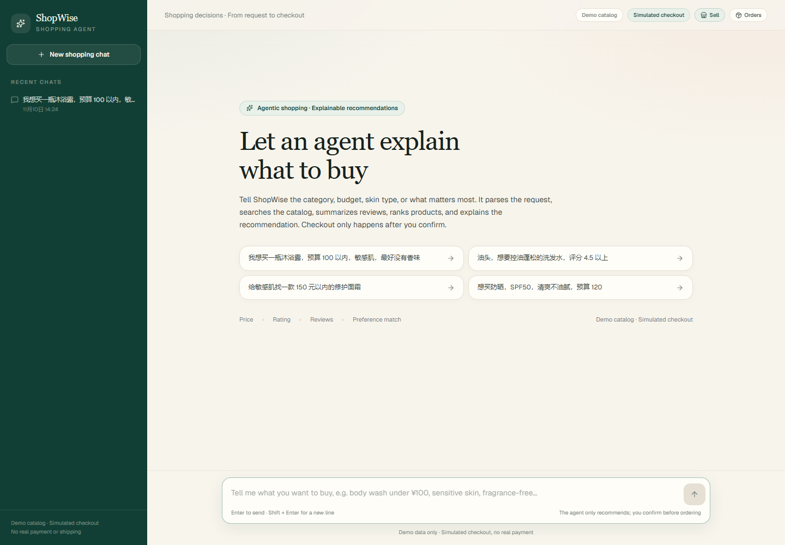
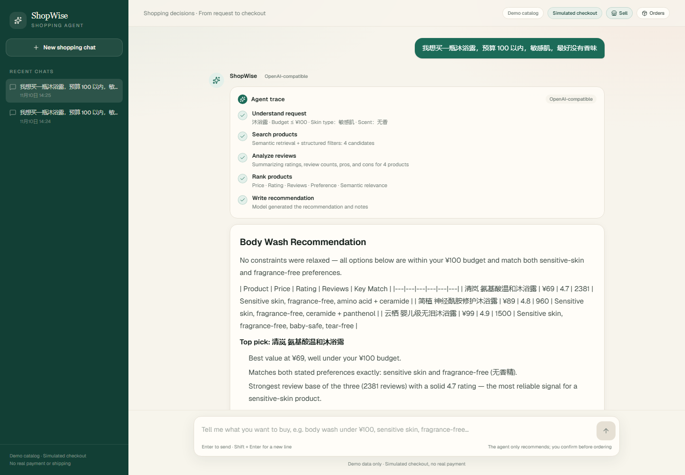
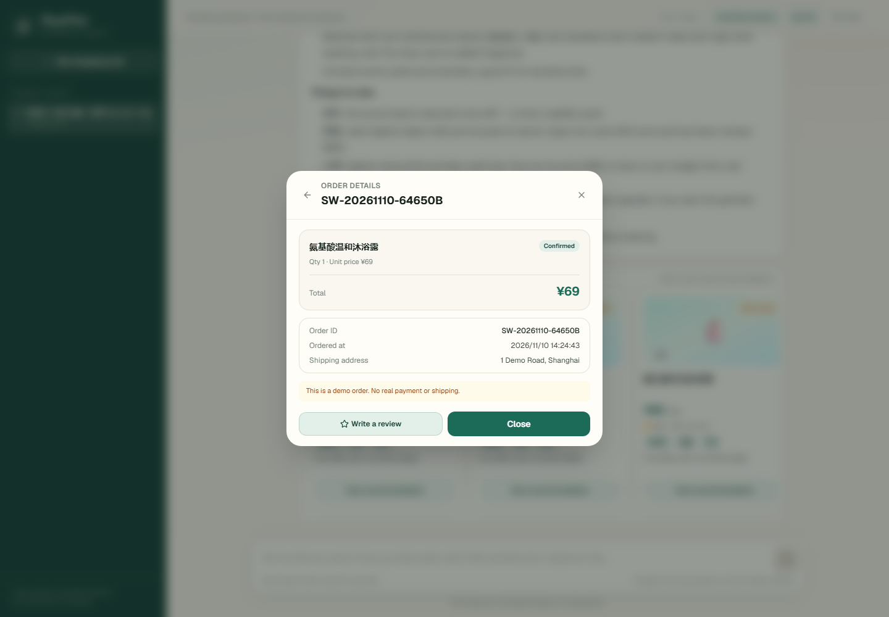
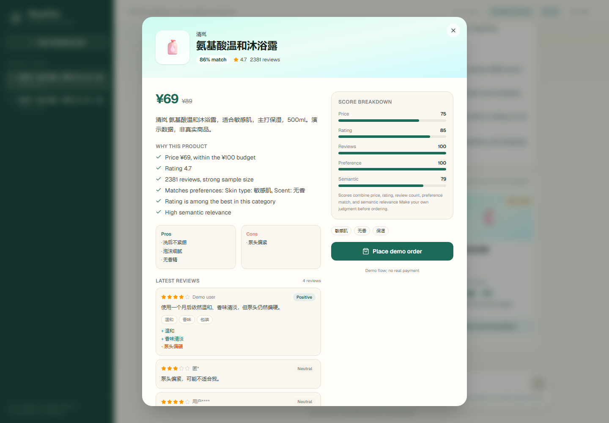
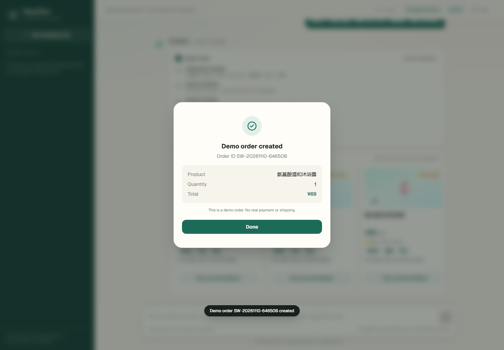
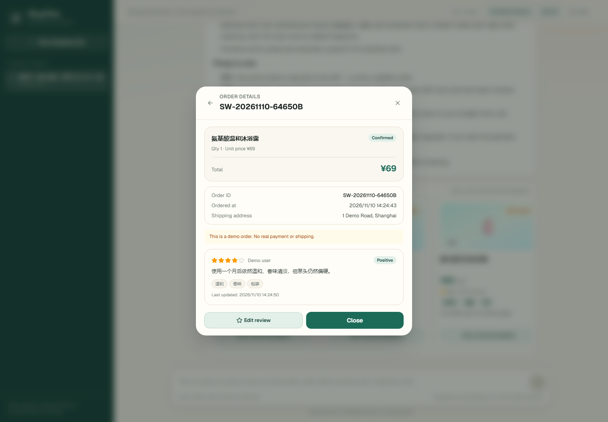
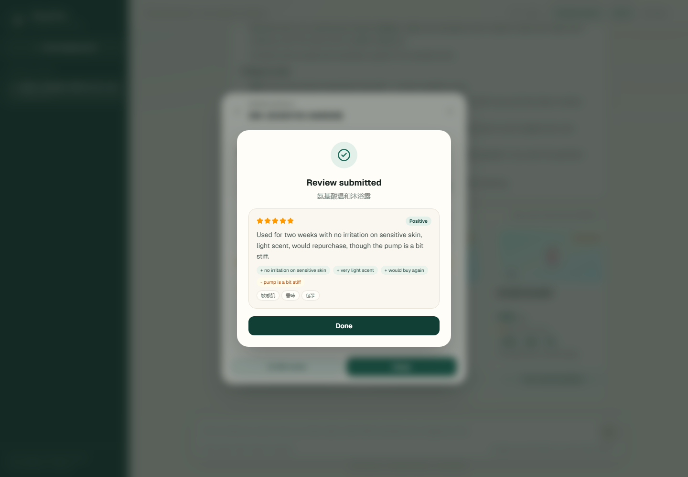
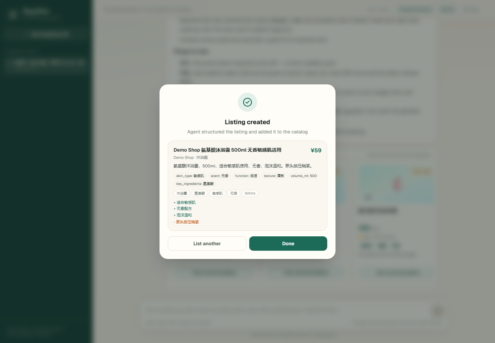
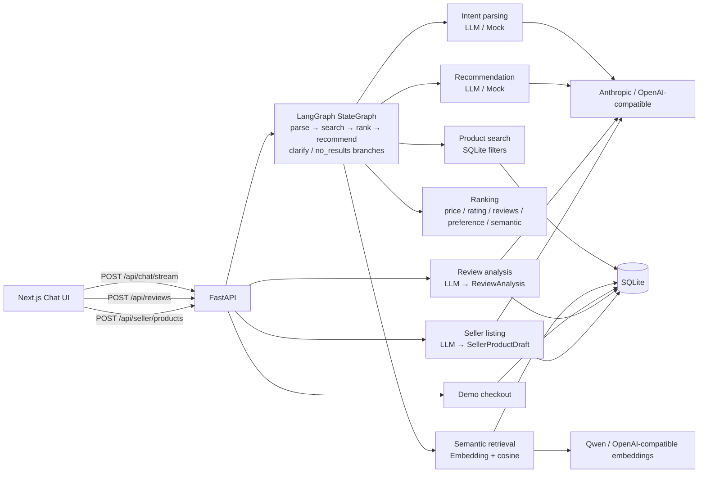
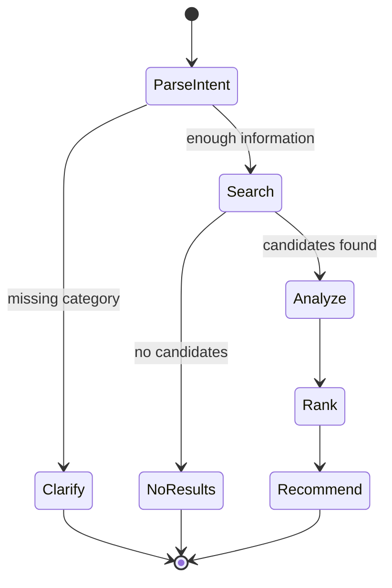

# ShopWise · Explainable Shopping Agent

> A full-stack agent that understands shopping preferences, compares products, explains its recommendation, and places a demo order only after the user confirms.


ShopWise is a portfolio project for learning and demonstrating agent application development. The demo catalog and example prompts are in Chinese; the code, UI, and documentation are in English.

---

## 1. What it does

A user can type:

> 我想买一瓶沐浴露，预算 100 以内，敏感肌，最好没有香味

ShopWise will:

1. **Understand the request** — category, budget, skin type, scent, brands, exclusions, priorities.
2. **Retrieve products** — structured filters plus optional embedding-based semantic retrieval.
3. **Analyze reviews** — ratings, review counts, pros and cons.
4. **Rank products** — price, rating, reviews, preference match, and semantic relevance, with an explainable score breakdown.
5. **Write a recommendation** — top-3 table, top pick, reasons, and caveats, streamed token by token.
6. **Confirm the order** — a demo order is created only after the user clicks confirm.
7. **Review the purchase** — the buyer can write, view, and edit one review per order; an LLM structures it into sentiment, a summary, pros, cons, and tags for future shoppers.
8. **Sell a product** — a seller describes an item and sets the price/category; an LLM structures the listing into a product record that enters the buyer catalog immediately.

### Screenshots

| Home | Recommendation | Order details |
|---|---|---|
|  |  |  |

| Product details | Demo order created |
|---|---|
|  |  |

| View and edit a review | Structured review result | Seller listing created |
|---|---|---|
|  |  |  |

---

## 2. Features

- [x] Product catalog with category, price, rating, and keyword filters
- [x] Optional semantic retrieval with embeddings and cosine similarity
- [x] Explainable multi-criteria ranking
- [x] Intent parsing with an LLM or a deterministic rule-based fallback
- [x] Mock mode that runs without API keys
- [x] SQLite persistence for sessions, messages, orders, and reviews
- [x] LangGraph `StateGraph` workflow with conditional branches
- [x] SSE streaming for stages, products, and recommendation tokens
- [x] Demo checkout with explicit user confirmation
- [x] Order history and order details
- [x] Post-purchase reviews with LLM structuring
- [x] Review viewing and editing; one review per order
- [x] Seller listings: free-text description → LLM-structured product → buyer catalog
- [x] Session replay with persisted product score snapshots
- [ ] Evaluation set, Docker, CI, and public deployment

---

## 3. Architecture



| Layer | Responsibility | Directory |
|---|---|---|
| UI | Chat, product cards, agent trace, checkout, order history, reviews, seller listing | `frontend/` |
| API | Routes, validation, SSE, errors | `backend/app/api/` |
| Agent | Intent parsing, LangGraph workflow, prompts, provider abstractions | `backend/app/agent/` |
| Services | Catalog search, semantic scoring, ranking, reviews, sessions | `backend/app/services/` |
| Data | SQLModel tables, product embeddings, seed catalog | `backend/app/models.py`, `backend/app/data/` |

---

## 4. Tech stack

**Backend**

- Python 3.11+
- FastAPI + Uvicorn
- Pydantic v2 + SQLModel
- SQLite (development; PostgreSQL is a production option)
- LangGraph `StateGraph`
- Anthropic SDK + OpenAI SDK for OpenAI-compatible providers
- Qwen or any OpenAI-compatible embedding endpoint
- SSE via `sse-starlette`

**Frontend**

- Next.js 16 App Router
- TypeScript
- Tailwind CSS 4
- lucide-react

**Tooling**

- pytest
- Ruff
- Playwright smoke test and screenshot script

---

## 5. Quick start

### 5.1 Backend

```bash
cd backend
python -m venv .venv
# Windows
.venv\Scripts\activate
# macOS / Linux
# source .venv/bin/activate

pip install -e ".[dev]"
cp .env.example .env
uvicorn app.main:app --reload --port 8000
```

Open <http://localhost:8000/docs> for the OpenAPI documentation.

### 5.2 Frontend

```bash
cd frontend
npm install
cp .env.local.example .env.local
npm run dev
```

Open <http://localhost:3000>.

> On Windows, if `next dev` hits a Turbopack panic (`0xc0000142`), delete `.next` and retry. If it still fails, use `npm run build && npm run start`.

### 5.3 Run without API keys

```env
LLM_PROVIDER=mock
EMBEDDING_PROVIDER=disabled
```

Mock mode uses deterministic rules and is suitable for UI work, tests, and offline demos. Set `EMBEDDING_PROVIDER=mock` to test semantic retrieval locally without a key.

---

## 6. Environment variables

`backend/.env`:

```env
# mock | anthropic | openai
LLM_PROVIDER=mock

# Anthropic
ANTHROPIC_API_KEY=
ANTHROPIC_BASE_URL=
LLM_MODEL=claude-opus-5-5

# OpenAI-compatible (DeepSeek / Qwen / Zhipu ...)
OPENAI_API_KEY=
OPENAI_BASE_URL=https://api.deepseek.com/v1
OPENAI_MODEL=deepseek-chat
# Optional provider-specific body
# LLM_EXTRA_BODY_JSON={"thinking":{"type":"disabled"}}

# Semantic retrieval: disabled | openai | mock
EMBEDDING_PROVIDER=disabled
EMBEDDING_API_KEY=
EMBEDDING_BASE_URL=https://maas.qianwenaiapi.com/compatible-mode/v1
EMBEDDING_MODEL=qwen3.7-text-embedding
EMBEDDING_BATCH_SIZE=20

DATABASE_URL=sqlite:///./data/shopwise.db
CORS_ORIGINS=http://localhost:3000,http://127.0.0.1:3000
```

`DEEPSEEK_API_KEY` / `DEEPSEEK_BASE_URL` and `DASHSCOPE_API_KEY` are accepted as fallbacks. Never commit `.env`.

---

## 7. API overview

| Method | Path | Description |
|---|---|---|
| GET | `/api/health` | Health check with provider and semantic status |
| GET | `/api/products` | List/filter products |
| GET | `/api/products/{id}` | Product details |
| GET | `/api/products/{id}/reviews` | Latest reviews with structured analysis |
| POST | `/api/chat` | Non-streaming shopping consultation |
| POST | `/api/chat/stream` | SSE streaming consultation |
| GET | `/api/sessions` | Session list |
| GET | `/api/sessions/{id}` | Session history |
| POST | `/api/orders` | Create a demo order |
| GET | `/api/orders` | Order list |
| GET | `/api/orders/{id}` | Order details |
| GET | `/api/orders/{id}/review` | Review for an order |
| POST | `/api/reviews` | Submit a review |
| PUT | `/api/reviews/{id}` | Edit a review |
| POST | `/api/seller/products` | Create a seller listing |
| GET | `/api/seller/products` | List a seller's products |

See `/docs` for the full schema.

---

## 8. Agent workflow



The graph is compiled once in `backend/app/agent/orchestrator.py`:

- `run_shopping_agent` uses `graph.ainvoke(...)`.
- `stream_shopping_agent` uses `graph.astream(..., stream_mode="custom")`; nodes push events through `get_stream_writer()`.

Design principles:

- **Rules before generation** — budgets, categories, and exclusions are enforced by deterministic code; the LLM handles fuzzy language and explanations.
- **Hybrid retrieval** — structured filters guarantee hard constraints; embeddings add a soft relevance signal.
- **Explainable ranking** — every product exposes a score breakdown and reasons.
- **Human confirmation** — the agent never places an order automatically.
- **Graceful degradation** — LLM and embedding failures fall back to rules without breaking the chat.

More detail: [docs/LANGGRAPH.md](docs/LANGGRAPH.md).

---

## 9. Ranking

```text
score = w_price * price_score
      + w_rating * rating_score
      + w_reviews * review_score
      + w_preference * preference_score
      + w_semantic * semantic_score
```

- `price_score`: normalized within the candidate set, cheaper is better
- `rating_score`: normalized rating
- `review_score`: log-normalized review count
- `preference_score`: attribute match ratio
- `semantic_score`: cosine similarity between the query and a product embedding

Default weights: price 25%, rating 25%, reviews 10%, preference 20%, semantic 20%.
User priorities add 0.15 to the selected dimension and renormalize. When embeddings are disabled, the semantic dimension is removed and the remaining weights are renormalized.

---

## 10. Reviews

`POST /api/reviews` accepts an order ID, a 1–5 rating, and text. The backend validates that the order belongs to the user and has not already been reviewed. An LLM (or the rule-based fallback) produces a `ReviewAnalysis`:

```python
class ReviewAnalysis(BaseModel):
    sentiment: Literal["positive", "neutral", "negative"]
    summary: str
    pros: list[str]
    cons: list[str]
    tags: list[str]
```

Reviews are stored in SQLite and shown on the product detail page. `PUT /api/reviews/{id}` re-runs the analysis and replaces the old rating contribution in the product aggregate without increasing the review count. SQLite migrations are idempotent; production deployments should use Alembic.

---

## 11. Seller listings

`POST /api/seller/products` accepts a free-text description, a price, a category, an optional brand, and a seller ID.

- The price and category come from the seller form and are never changed by the model.
- The LLM returns a `SellerProductDraft` with a name, brand, cleaned description, attributes, pros, cons, and tags.
- If the LLM fails, a rule-based analyzer produces the same structure and the response is marked `degraded=true`.
- The product is saved with `seller_id`, initial `rating=0`, and `review_count=0`, and appears in the buyer catalog immediately.
- `GET /api/seller/products?seller_id=...` lists a seller's listings.

---

## 12. Tests

```bash
cd backend
pytest -q
ruff check app tests

cd ../frontend
npm run build
node scripts/e2e-smoke.mjs   # requires both servers
```

---

## 13. Project structure

```text
backend/
  app/
    main.py              # FastAPI assembly, lifespan, routers
    config.py            # environment settings
    db.py                # engine, session, lightweight migrations
    models.py            # SQLModel tables
    schemas.py           # API request/response models
    seed.py              # demo catalog seeding
    api/                 # health, products, chat, orders, reviews, sessions
    agent/               # LangGraph workflow, prompts, providers
    services/            # catalog, ranking, semantic, reviews, sessions
    data/products.json   # Chinese demo catalog
  tests/
frontend/
  src/
    app/                 # Next.js pages
    components/          # chat, product, order, review UI
    lib/                 # API client, types, history replay
  scripts/               # Playwright smoke test and screenshots
docs/
```

---

## 14. Notes

- The demo catalog, product names, and example prompts are in Chinese; the UI and codebase are in English.
- Seller listings start with no ratings or reviews, so they rank as new products until buyers review them.
- Orders are simulated: no payment, inventory, or shipping.
- Product data is fictional and intended for demonstration only.
- No real e-commerce site is scraped. Use official APIs and respect platform terms if you connect real data.

---

## 15. License

MIT. Add a `LICENSE` file before publishing if needed.
