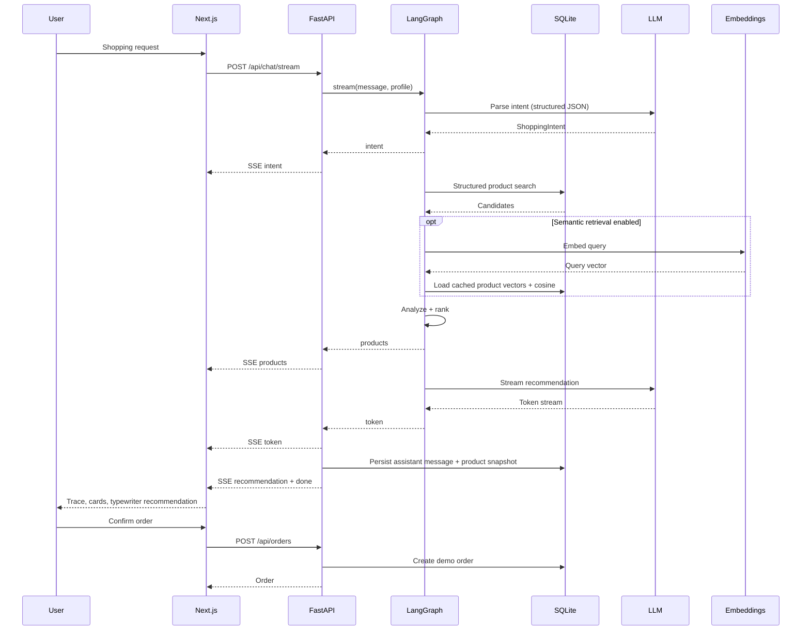

# ShopWise Architecture

> Design goals: understand fuzzy requests, enforce hard constraints, explain every recommendation, and require user confirmation before any order.

---

## 1. Design goals

| Goal | Implementation |
|---|---|
| Understand | Natural-language category, budget, attributes, brands, exclusions, priorities |
| Constrain | SQL/rules enforce budget, category, rating, brands, and excluded keywords |
| Explain | Every product has a score breakdown, reasons, and warnings |
| Confirm | The agent creates a purchase proposal; the user creates the order |
| Replace | LLM and embedding providers are behind small protocols |
| Reproduce | Mock mode, seed data, deterministic tests |

---

## 2. Request flow



---

## 3. Data model

### 3.1 Product

| Field | Description |
|---|---|
| `id` | Product ID such as `bw-001` |
| `name`, `brand`, `category` | Catalog identity |
| `price`, `original_price` | Current and original price |
| `rating`, `review_count` | Aggregate rating data |
| `description` | Product description |
| `attributes` | JSON attributes such as skin type, scent, volume |
| `pros`, `cons`, `tags` | JSON display data |
| `image_key` | Frontend placeholder key |
| `seller_id` | Seller owner for listings; null for seed products |

### 3.2 Review

| Field | Description |
|---|---|
| `product_id`, `rating`, `content`, `author` | Raw review |
| `user_id`, `order_id` | Present for submitted reviews; one review per order |
| `sentiment`, `summary` | LLM or fallback analysis |
| `pros`, `cons`, `tags` | Structured JSON analysis |
| `created_at`, `updated_at` | Timestamps |

Review flow:

```text
POST /api/reviews
  → validate order ownership, status, and duplicate review
  → provider.analyze_review(content, rating)
  → ReviewAnalysis (Pydantic validation)
  → save Review
  → update Product.rating / review_count incrementally
  → GET /api/products/{id}/reviews

PUT /api/reviews/{id}
  → validate ownership
  → re-run analysis
  → update review and updated_at
  → replace the old rating contribution; review_count is unchanged
```

If LLM analysis fails, a rule-based `MockProvider.analyze_review` is used and the response is marked `degraded=true`.

### 3.3 ChatSession / ChatMessage

`ChatSession.profile` stores the accumulated shopping profile:

```json
{
  "category": "沐浴露",
  "budget_max": 100,
  "min_rating": 4.5,
  "attributes": {"skin_type": "敏感肌", "scent": "无香"},
  "brands_exclude": [],
  "priorities": ["价格", "评分"]
}
```

`ChatMessage.meta` stores `provider`, `intent`, a full `ScoredProduct` snapshot, `purchase_proposal`, and related fields. The frontend replays this snapshot when a user opens a historical session.

### 3.4 Order

| Field | Description |
|---|---|
| `id` | Demo order number |
| `user_id`, `session_id` | Ownership and source session |
| `product_id`, `product_name` | Product snapshot |
| `quantity`, `unit_price`, `total_price` | Server-side prices |
| `status`, `address`, `created_at` | Demo order state |

### 3.5 ProductEmbedding

Caches product vectors keyed by `product_id` and `model`; `text_hash` invalidates stale rows when product text changes.

### 3.6 Seller listing

```text
POST /api/seller/products
  → validate category against the catalog
  → provider.analyze_product_description(description, category, price, brand)
  → SellerProductDraft (Pydantic validation)
  → save Product with seller_id, rating=0, review_count=0
  → the product is immediately searchable by buyers
```

The form-authoritative `price` and `category` are never changed by the model. If LLM analysis fails, a rule-based `MockProvider.analyze_product_description` is used and the response is marked `degraded=true`.

### 3.7 AgentTask

| Field | Description |
|---|---|
| `id` | Task ID used for confirmation |
| `user_id`, `goal` | Owner and original goal |
| `status` | `planned`, `awaiting_confirmation`, `completed`, `failed`, `needs_input` |
| `risk` | `read`, `write`, or `high_risk` |
| `plan` | Serialized `AgentPlan` |
| `results` | Structured results from skills |
| `draft` | Pending write draft awaiting confirmation |
| `created_at`, `updated_at` | Timestamps |

Task agent flow:

```text
POST /api/agent/tasks
  → planner produces AgentPlan
  → policy validates skills, risk, quantity, and caps
  → execute read/draft skills
  → stop at the first write step with a draft
POST /api/agent/tasks/{id}/confirm
  → validate ownership and state
  → re-check server-side price/quantity
  → execute once; repeated confirmation is idempotent
```

Skills:

| Skill | Risk | Execution |
|---|---|---|
| `recommend` | read | Existing shopping workflow |
| `order` | write | Order draft, then confirmed order |
| `sell` | write | Seller draft, then confirmed product |
| `flash_sale` | high risk | Simulated purchase with caps, then confirmed demo order |

The policy layer owns confirmation and risk: the model cannot downgrade a write step or bypass confirmation. Flash purchase is simulated and does not call a real platform or payment API.

---

## 4. LangGraph workflow

State: `ShoppingGraphState` in `backend/app/agent/orchestrator.py`.

| Node | Input | Output | LLM |
|---|---|---|---|
| `parse_intent` | message + profile | intent, merged profile, degraded, clarification | Yes |
| `clarify` | clarification | internal `_final` result | No |
| `search` | profile | products, relaxations | No |
| `no_results` | empty products | fallback recommendation + `_final` | No |
| `analyze` | products | no state change (extension point) | No |
| `rank` | products + profile + semantic scores | scored top N | No (embedding API) |
| `recommend` | scored + intent | recommendation, top product, `_final` | Yes |

Conditional edges:

- `parse_intent` → `clarify` / `search`
- `search` → `no_results` / `analyze`
- `analyze → rank → recommend → END`

Runtime dependencies (`session`, `provider`, `embedding_provider`, `stream_recommendation`) live in `config["configurable"]`.

---

## 5. Ranking

```text
price_score = 1 - normalize(price)
rating_score = normalize(rating, 3.0, 5.0)
review_score = log(1 + review_count) / log(1 + max_review_count)
preference_score = matched_attributes / total_attributes
semantic_score = cosine(query_vector, product_vector)
```

Default weights: price 25%, rating 25%, reviews 10%, preference 20%, semantic 20%. User priorities add 0.15 to a dimension and renormalize. When embeddings are disabled, the semantic dimension is removed and the remaining weights are renormalized.

Hard constraints:

- price above budget
- rating below minimum
- excluded brands or keywords
- attribute preferences narrow the shortlist when at least three exact matches exist

If no products match, the search relaxes minimum rating, then budget by 20%, then category popularity, and records every relaxation.

---

## 6. SSE protocol

`POST /api/chat/stream` returns `text/event-stream`:

| Event | Data |
|---|---|
| `session` | `{session_id, provider}` |
| `stage` | `{stage, status, label}` |
| `intent` | `{intent}` |
| `products` | `{products, relaxations}` |
| `token` | `{text}` |
| `recommendation` | `{provider, recommendation, top_product_id, purchase_proposal, clarification, relaxations, degraded}` |
| `done` | `{session_id, message_id}` |
| `error` | `{code, message}` |

The streaming route owns its database session because the response can stay open for tens of seconds. The final `recommendation` event replaces any partial tokens, so a failed model stream does not leave a half-finished answer.

The frontend uses `fetch` + `ReadableStream`, not `EventSource`, because it needs POST and custom JSON payloads.

---

## 7. Providers

```python
class LLMProvider(Protocol):
    async def parse_intent(...) -> ShoppingIntent: ...
    async def write_recommendation(...) -> str: ...
    async def stream_recommendation(...) -> AsyncIterator[str]: ...
    async def analyze_review(...) -> ReviewAnalysis: ...
    async def analyze_product_description(...) -> SellerProductDraft: ...
    async def plan_tasks(goal: str) -> AgentPlan: ...
```

| Provider | Use |
|---|---|
| `MockProvider` | No-key demos, tests, rule-based fallback |
| `AnthropicProvider` | Claude SDK |
| `OpenAICompatibleProvider` | DeepSeek, Qwen, Zhipu, and other compatible APIs |

Embeddings use a separate protocol:

```python
class EmbeddingProvider(Protocol):
    async def embed(self, texts: list[str]) -> list[list[float]]: ...
```

Fallbacks:

- LLM failure → mock recommendation, `degraded=true`
- Invalid structured output → rule-based parser
- Embedding initialization failure → semantic retrieval disabled
- Query embedding failure → continue with structured ranking
- Review analysis failure → rule-based analysis, review still saved

---

## 8. Directory structure

```text
backend/app/
  main.py                 # FastAPI assembly, lifespan, routers
  config.py               # environment settings
  db.py                   # engine, session, SQLite migrations
  models.py               # SQLModel tables
  schemas.py              # API models
  seed.py                 # demo catalog seeding
  api/
    routes_health.py
    routes_products.py
    routes_chat.py
    routes_orders.py
    routes_reviews.py
    routes_seller.py
    routes_agent.py
    routes_sessions.py
  agent/
    state.py              # Intent / Profile / ScoredProduct / ReviewAnalysis
    llm.py                # LLM provider protocol
    embeddings.py         # Embedding provider protocol
    mock.py               # rule-based provider
    anthropic_provider.py
    openai_provider.py
    orchestrator.py       # LangGraph graph, nodes, run/stream entry points
    prompts.py
  services/
    catalog.py            # structured search and relaxation
    semantic.py           # vector cache and cosine similarity
    ranking.py            # weighted ranking
    reviews.py            # review analysis, persistence, aggregate update
    seller.py             # seller listing analysis and product persistence
    agent_policy.py       # plan validation, risk, caps, confirmation
    agent_tasks.py        # supervisor execution and confirmation
    sessions.py           # sessions and profile merging
  data/products.json      # Chinese demo catalog
```

---

## 9. Trade-offs

| Decision | Choice | Reason | Cost |
|---|---|---|---|
| Data source | Local demo catalog | Reproducible, no scraping risk | Not real products |
| Ranking | Weighted rules + LLM explanation | Explainable and testable | Less flexible than pure LLM |
| Retrieval | Embeddings as a ranking signal | Complement keyword gaps without violating constraints | Extra API call and vector storage |
| Seller listings | LLM structures the description; form owns price/category | Consistent, searchable listings without letting the model set price | LLM may omit details; rule-based fallback |
| Task agent | Planner over deterministic skill workflows | Adds autonomy without giving the model direct side effects | Policy and confirmation add complexity |
| Flash purchase | Simulated, capped, confirmation-gated | Safe demo of a high-risk skill | Not connected to a real platform |
| Checkout | User confirmation + demo order | Safe to demo | No real payment |
| Database | SQLite | Zero setup | Limited concurrency |
| Frontend | Next.js | Strong portfolio signal | Heavier than Vite |
| Orchestration | LangGraph StateGraph | Explicit state, edges, and branches | Learning curve |

---

## 10. Interview questions

1. Why not let the LLM choose the product directly?
2. How are ranking weights chosen and validated?
3. How does the system handle “make it cheaper”?
4. What happens when the model returns invalid JSON?
5. How are over-budget products prevented?
6. How are duplicate orders and price tampering prevented?
7. SSE vs WebSocket: why SSE here?
8. How would the architecture change at one million products?
9. How do you evaluate recommendation quality?
10. How does semantic retrieval avoid over-budget products?
11. How does the system degrade when embeddings fail?
12. How do you prevent duplicate, abusive, or unauthorized reviews?
