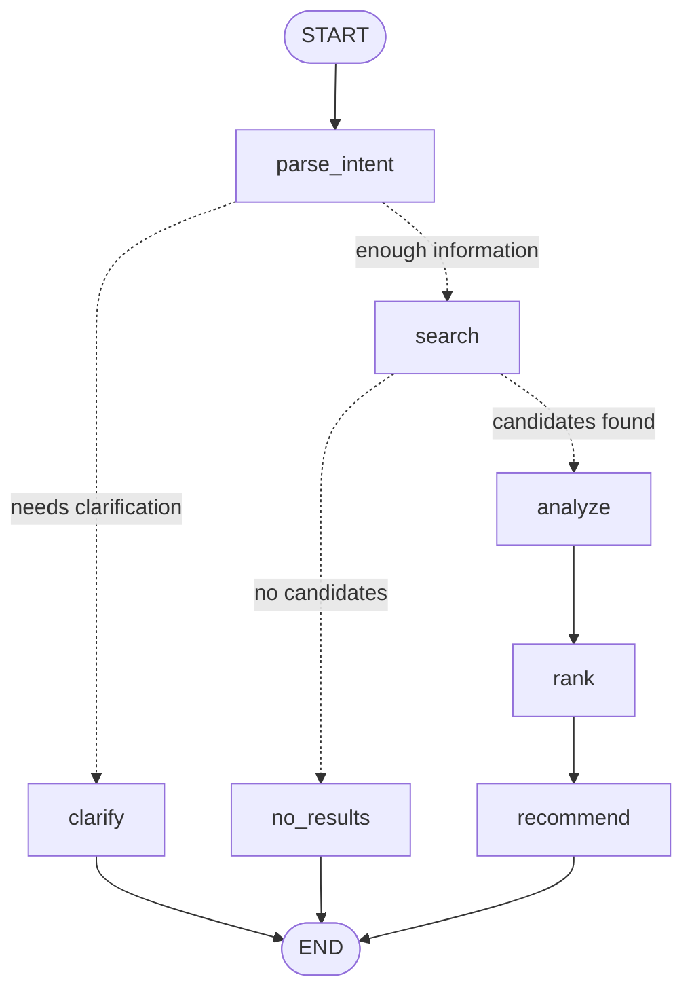

# ShopWise LangGraph Workflow

> How the `StateGraph` in `backend/app/agent/orchestrator.py` works: state, nodes, conditional edges, and custom streaming.

---

## 1. Why LangGraph

The first version of the workflow was a linear async function with `if/else` branches. That becomes hard to maintain once the flow includes clarification, no-result handling, tool calls, retries, and human confirmation.

LangGraph makes the structure explicit:

- **State**: data that flows between nodes.
- **Node**: one stage, implemented as a function.
- **Edge**: a normal transition.
- **Conditional edge**: choose the next node from state.
- **Compile**: validate the graph and return an executable runnable.
- **ainvoke / astream**: non-streaming and streaming execution.

---

## 2. Graph



Dashed lines are conditional edges.

---

## 3. State

```python
class ShoppingGraphState(TypedDict, total=False):
    message: str
    profile: ShoppingProfile
    intent: ShoppingIntent
    degraded: bool
    clarification: str | None
    products: list[Product]
    relaxations: list[str]
    scored: list[ScoredProduct]
    recommendation: str
    top_product_id: str | None
```

Key ideas:

1. `TypedDict` describes fields; it is not a database table.
2. `total=False` means the initial input does not need every field.
3. A node returns a partial update; LangGraph merges it into state.

Runtime dependencies are not part of state:

```python
class ShoppingGraphConfig(TypedDict, total=False):
    session: Session
    provider: LLMProvider
    embedding_provider: EmbeddingProvider | None
    stream_recommendation: bool
```

They live in `config["configurable"]`, keeping state focused on workflow data.

---

## 4. Nodes

### `parse_intent`

- Emits `stage(parse_intent, active)`.
- Calls the LLM or rule-based intent parser.
- Emits `intent` and `stage(parse_intent, done)`.
- Returns `intent`, merged `profile`, `degraded`, and `clarification`.

### `clarify`

- Emits an internal `_final` event carrying an `AgentResult`.
- Ends the graph when a category is missing.

### `search`

- Applies structured catalog filters.
- Emits `stage(search, active/done)`.
- Returns `products` and `relaxations`.

### `no_results`

- Emits a fallback recommendation through `_final`.
- Ends the graph when no candidates match.

### `analyze`

- Emits `stage(analyze, active/done)`.
- Currently a placeholder; review summarization can be added here later.

### `rank`

- Runs semantic scoring and weighted ranking.
- Emits a `products` event and `stage(rank, active/done)`.
- Returns `scored`.

### `recommend`

- Builds a recommendation context.
- In streaming mode, calls `provider.stream_recommendation` and emits each token.
- In non-streaming mode, calls `provider.write_recommendation`.
- Emits `stage(recommend, active/done)` and a final `_final` event.

---

## 5. Building the graph

```python
def build_shopping_graph():
    graph = StateGraph(ShoppingGraphState)

    graph.add_node("parse_intent", parse_intent_node)
    graph.add_node("clarify", clarify_node)
    graph.add_node("search", search_node)
    graph.add_node("no_results", no_results_node)
    graph.add_node("analyze", analyze_node)
    graph.add_node("rank", rank_node)
    graph.add_node("recommend", recommend_node)

    graph.add_edge(START, "parse_intent")
    graph.add_conditional_edges(
        "parse_intent",
        route_after_intent,
        {"clarify": "clarify", "search": "search"},
    )
    graph.add_edge("clarify", END)

    graph.add_conditional_edges(
        "search",
        route_after_search,
        {"no_results": "no_results", "analyze": "analyze"},
    )
    graph.add_edge("no_results", END)

    graph.add_edge("analyze", "rank")
    graph.add_edge("rank", "recommend")
    graph.add_edge("recommend", END)

    return graph.compile()
```

`compile()` validates the graph and returns a runnable. Compile it once at module import time, not per request.

---

## 6. Invocation and streaming

### Non-streaming

```python
final_state = await shopping_graph.ainvoke(
    {"message": message, "profile": profile},
    config=_graph_config(..., stream_recommendation=False),
)
return _result_from_state(final_state)
```

### Streaming

```python
async for event in shopping_graph.astream(
    {"message": message, "profile": profile},
    config=config,
    stream_mode="custom",
):
    if isinstance(event, AgentEvent):
        yield event
```

Nodes emit custom events with:

```python
def _emit(event: AgentEvent) -> None:
    get_stream_writer()(event)
```

- With `stream_mode="custom"`, events are yielded by `astream`.
- With `ainvoke`, the writer is a no-op.
- This lets the same nodes support both entry points.

Event order:

```text
stage(parse_intent active)
intent
stage(parse_intent done)
stage(search active) → stage(search done)
stage(analyze active) → stage(analyze done)
stage(rank active)
products
stage(rank done)
stage(recommend active)
token × N
stage(recommend done)
_final   # internal event consumed by the SSE route
```

---

## 7. Adding a node

1. Add a field to `ShoppingGraphState`.
2. Write an async node that returns a partial update.
3. Register it with `add_node`.
4. Add an edge or conditional edge.
5. Add a unit test that calls the node directly.

Example: a review-summary node could add `review_summary` to state, emit `stage(analyze, ...)`, and return the summary. `recommend_node` could then include it in `RecommendationContext`.

---

## 8. Common pitfalls

1. Nodes must return a dict; do not mutate state directly.
2. State updates are merged; returning `{"products": [...]}` does not clear `intent`.
3. Every key returned by a conditional-edge router must exist in the path map.
4. `get_stream_writer()` is a no-op outside a streaming run.
5. Compile the graph once at module level.
6. Keep large runtime dependencies in config, not state.
7. Event payloads must eventually be JSON-serializable at the API layer.
8. Async nodes must use `await`; SQLite sessions are configured with `check_same_thread=False`.

---

## 9. Verify

```python
from app.agent.orchestrator import shopping_graph

print(shopping_graph.get_graph().draw_mermaid())
print(shopping_graph.get_graph().nodes.keys())
```

```bash
cd backend
pytest -q
```
