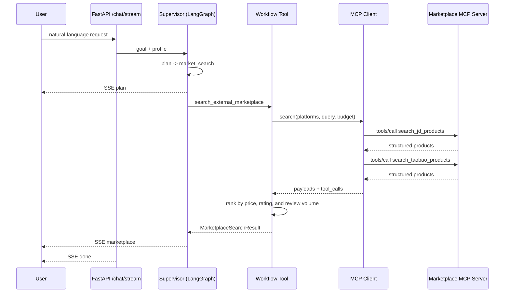

# MCP External Tools

ShopWise does not hardcode marketplace APIs inside the agent. It discovers and invokes
external tools through the [Model Context Protocol](https://modelcontextprotocol.io/).
Adding a platform or changing a data source means replacing the MCP server, not rewriting
the planner.

## 1. Why MCP

A traditional implementation grows platform-specific branches:

```python
if "JD" in message:
    results = await jd_search(...)
elif "Taobao" in message:
    results = await taobao_search(...)
```

Each integration has its own parameters, error shape, and authentication. MCP standardizes
the contract:

```text
tools/list  -> tool names, descriptions, JSON Schemas
tools/call  -> invoke a tool and receive a structured result
```

The agent needs to know which tools exist and what arguments they accept. It does not need
to know whether the implementation uses HTTP, a database, or a browser.

## 2. Project layout

```text
backend/app/mcp/
├── marketplace_server.py   # standalone stdio MCP server with three tools
├── client.py               # tools/list + tools/call
├── service.py              # normalize and rank external products
└── models.py               # marketplace result models

backend/app/workflows/marketplace.py  # comparison workflow
backend/app/api/routes_mcp.py         # GET /api/mcp/tools
```

The bundled server exposes:

| Tool | Purpose |
|---|---|
| `search_jd_products` | Search JD demo products by category, budget, and keywords |
| `search_taobao_products` | Search Taobao/Tmall demo products |
| `get_marketplace_product` | Read one external product's details |

> The demo dataset is fixed. It does not scrape JD or Taobao and never places a real order
> or payment. This keeps the repository runnable offline, makes tests reproducible, and
> avoids platform-terms problems.

## 3. Tool discovery at startup

`backend/app/main.py` creates `MCPMarketplaceClient` in the lifespan and runs `tools/list`
once. The catalog is cached in `app.state.mcp`:

```text
INFO app.main: MCP marketplace: 3 tools discovered via stdio
(search_jd_products, search_taobao_products, get_marketplace_product)
```

The **MCP** button in the UI calls:

```http
GET /api/mcp/tools
```

Example response:

```json
{
  "enabled": true,
  "available": true,
  "transport": "stdio",
  "server": "shopwise-marketplace",
  "tools": [
    {
      "name": "search_jd_products",
      "description": "Search JD demo products by category and budget...",
      "input_schema": {
        "type": "object",
        "properties": {
          "query": {"type": "string"},
          "category": {"type": ["string", "null"]},
          "budget_max": {"type": ["number", "null"]},
          "limit": {"type": "integer"}
        },
        "required": ["query"]
      }
    }
  ]
}
```

`POST /api/mcp/tools/refresh` runs discovery again without restarting the backend.

## 4. What happens during a comparison

User input:

> 帮我找京东和淘宝上 100 元以内的护肤霜，比较价格和评价后推荐三款性价比最高的。



Ranking:

```text
value = 40% price + 35% rating + 25% review volume + explicit-need match boost
```

When both platforms participate, the result keeps at least one product from each platform
so a cross-platform comparison does not collapse into a single-platform list. If the user
says "three products", the policy layer enforces `limit=3` even if the model proposes more.

## 5. Permission boundaries

| Capability | Risk | Automatic? |
|---|---|---|
| External marketplace search | read | yes |
| Local recommendation | read | yes |
| Local order creation | write | requires user confirmation |
| Seller listing | write | requires user confirmation |
| Flash purchase | high risk | requires user confirmation |

`agent_policy.py` enforces a key rule: **if a plan contains `market_search`, every later
order/flash-sale step is dropped**. External products are read-only and cannot be used to
create a local order, preventing the model from mixing two systems.

## 6. Configuration

The default needs no configuration: the client starts the bundled MCP server over stdio
using the current Python interpreter.

```env
MCP_ENABLED=true
MCP_MARKETPLACE_TIMEOUT_SECONDS=30
```

To connect a remote MCP server over Streamable HTTP:

```env
MCP_MARKETPLACE_URL=https://your-mcp-server.example.com/mcp
```

To use a custom stdio command:

```env
MCP_MARKETPLACE_COMMAND=/path/to/python
```

Tests can connect in-process and skip the subprocess:

```env
MCP_MARKETPLACE_INPROCESS=true
```

## 7. Running the server directly

```bash
cd backend
python -m app.mcp.marketplace_server
```

The process then waits for an MCP client over stdio. Never print logs to stdout in this
mode; stdout carries JSON-RPC frames. The demo server logs only to stderr.

## 8. Connecting a real marketplace

1. Use the platform's official open API or official MCP server; do not scrape pages.
2. Handle authentication, rate limits, signing, and field mapping inside the MCP server.
3. Keep search tools read-only. Model checkout as a separate tool that requires explicit
   user confirmation.
4. Set `MCP_MARKETPLACE_URL` in ShopWise's `.env`.
5. If the real server uses different tool names, the client matches `jd` / `taobao` hints
   against `search*` tools; extend `app/mcp/client.py` if needed.

Real integrations require accounts, keys, quotas, and platform compliance. This repository
does not include those credentials or any anti-bot bypass.

## 9. Tests

```bash
cd backend
pytest -q tests/test_mcp.py
```

Coverage:

- MCP tool discovery and input schemas
- JD-only search
- JD + Taobao comparison ranking
- Policy stripping write steps after external search
- Supervisor `plan → marketplace → done` event chain
